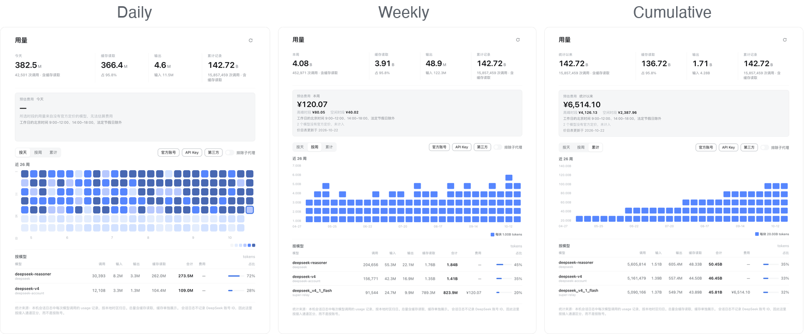
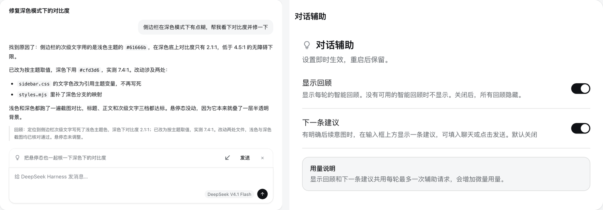

# dsh-plugins

Community plugins for [DeepSeek Harness](https://github.com/deepseek-ai/deepseek-harness) (DSH).

A monorepo: every plugin lives in its own package under `packages/`, so one checkout holds many
small, independently installable features while sharing a build script, a test runner, and a set of
conventions.

```
packages/
  dsh-usage-bill/    DeepSeek account balance and a token-usage heatmap
  dsh-session-assist/  per-turn recap, next-prompt suggestions, and ↑ prompt recall
scripts/
  build.mjs            builds every package's Host entry and browser bundle
docs/images/           screenshots referenced by the READMEs
```

## Plugins

Click a preview to open it full size.

| Package | What it does | Preview |
|---|---|---|
| [`dsh-usage-bill`](packages/dsh-usage-bill/) | DeepSeek balance and expiring credit in the sidebar.<br>Token-usage heatmap by day, week, or cumulative, one lane per model.<br>Peak/off-peak cost estimate. | <a href="docs/images/usage-views.png"></a> |
| [`dsh-session-assist`](packages/dsh-session-assist/) | A model recap after each completed turn, shown only when one is available.<br>Optional next-prompt suggestions you can insert as drafts or send.<br><kbd>↑</kbd> in an empty composer recalls the previous prompt. | <a href="docs/images/session-assist.png"></a> |

## Install a plugin

The packages are published to the internal registry (**bnpm**) under the `@byted-zhongkui` scope,
because bnpm refuses an unscoped name. Install one by its published name — either from the
**Plugins** page's npm field or with the CLI:

```bash
dsh plugin --profile <profile> add @byted-zhongkui/dsh-usage-bill
dsh plugin --profile <profile> add @byted-zhongkui/dsh-session-assist
dsh plugin --profile <profile> remove @byted-zhongkui/dsh-usage-bill
```

They are not on the public npm registry yet, so the bare names `dsh-usage-bill` and
`dsh-session-assist` do not resolve there. This repository keeps the unscoped names; the scoped
release name is derived at publish time (see [Publish](#publish)).

To work on a checkout instead, install it by path:

```bash
dsh plugin --profile <profile> add "link:/absolute/path/to/packages/dsh-usage-bill"
```

`link:` keeps the profile pointed at your checkout, so a rebuild plus a DSH restart picks up your
changes.

A profile applies its bundle list at startup, so **restart the app** after installing or rebuilding.
Rebuilding alone changes files on disk, not the code already loaded in memory. A `lib/index.js`
change (Host side) always needs that restart; a `lib/client.js` change (browser side) is enough to
reload the window.

## Build

```bash
npm run build                              # node scripts/build.mjs
node scripts/build.mjs dsh-session-assist  # one package
```

The build uses [Bun](https://bun.sh) as its bundler, so `bun` must be on `PATH`. It needs no
`install` step: packages have no runtime dependencies beyond the modules DSH already provides.
Runtime requirement is Node 20 or newer; nothing ships to `node_modules`.

Outputs, per package:

| Artifact | Shape |
|---|---|
| `lib/index.js` | ES module; exports `apply(ctx)` for the Host |
| `lib/client.js` | one `window.__ModuleLoader__.load()` factory for the browser |

Both are generated — edit `src/`, never `lib/`. A generated artifact that does not match `src/` is
worse than a missing one, because it looks authoritative.

## Test

```bash
npm test               # node scripts/test.mjs
npm run check          # build, then test
```

## Publish

`npm run check` first: the script publishes `lib/`, so unbuilt sources ship stale artifacts.

bnpm rejects an unscoped package (`can't publish private package with non-scoped`), and a scope
changes three things the loader resolves — the manifest name, the row `name` in
`cordis.patch.yml`, and the factory id in `lib/client.js`. `scripts/publish-bnpm.mjs` derives that
scoped copy in a temporary directory, so the checkout keeps its public-facing names:

```bash
node scripts/publish-bnpm.mjs dsh-usage-bill @byted-zhongkui --dry-run
node scripts/publish-bnpm.mjs dsh-usage-bill @byted-zhongkui
```

The row `id` deliberately keeps its unscoped spelling: it is a profile-local handle the loader
never resolves, and a `@`-leading YAML scalar would need quoting. Bump `version` before republishing
— bnpm refuses to overwrite a published version, and a bad version cannot be deleted by its owner.

Once published, `dsh plugin --profile <profile> add @byted-zhongkui/<name>` installs it. A version
newer than pnpm's `minimumReleaseAge` is not picked automatically; pin it or wait out the window.

The suites use `node --test` over the pure logic: folding, pricing, formatting, routing, and every
visibility decision. Browser-only code stays out of the tests, which is why anything that decides a
number or a state is a function in `src/shared/` rather than inline in a component.

## Plugin conventions

Every package follows the same shape, because that is what DSH's loader expects:

| File | Purpose |
|---|---|
| `package.json` | `dsh.bundle.patch` names the patch file; `dsh.client` declares the browser half |
| `cordis.patch.yml` | one `insert` row naming the package |
| `lib/index.js` | Host entry: an ES module exporting `apply(ctx)` |
| `lib/client.js` | Browser bundle: one `window.__ModuleLoader__.load()` factory |
| `src/` | sources; `lib/` is generated |
| `test/` | `node --test` suites over the pure logic |
| `locale/*.json` | display title and description for the plugin list, per language |
| `icon.svg` | the plugin's mark, for the plugin list and its own seats |

Six rules matter more than the rest, each learned from a defect this repository shipped:

- **Do not replace a shipped component.** A plugin contributes new seats; it does not occupy a
  single-occupant slot a shipped package already owns, because that breaks the product on upgrade.
- **Use the host's own primitives.** `Menu`, `SegmentedControl`, and `Switch` come from the shared
  module table (`dsh.client.external`), never a second copy — a bundled duplicate loses the theme
  tokens and the focus ring.
- **Keep display logic pure and tested.** Host code folds data; the browser formats and draws it.
  Everything that decides a number lives in a function a test can call without a browser.
- **Install styles for the plugin's lifetime, not a component's.** A seat the plugin only marks —
  such as a settings nav row — is on screen even when the plugin's own page is not, so a stylesheet
  that mounts with the page leaves that seat unstyled until the page is opened once.
- **Show a figure only from a recorded fact.** A balance that failed to read is not `¥0.00`, and a
  turn with no recap is not a reason to print the reply twice. A blank is honest; a substitute is
  not.
- **Never make the reader pay for a decoration.** A row that is usually empty, or a placeholder that
  appears before the real content, costs a glance on every turn.

## License

MIT — see [LICENSE](LICENSE).
