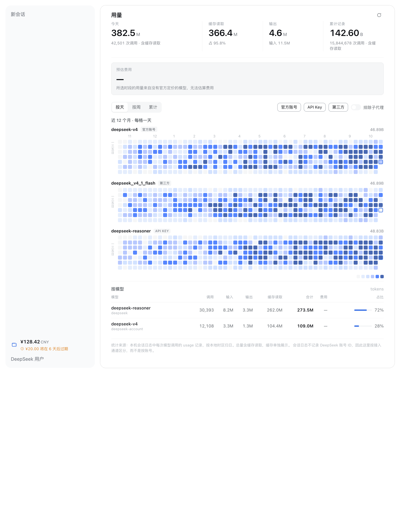

# dsh-plugins

Community plugins for [DeepSeek Harness](https://github.com/deepseek-ai/deepseek-harness) (DSH).

A monorepo: every plugin lives in its own package under `packages/`, so one checkout holds many
small, independently installable features while sharing a build script, a test runner, and a set of
conventions.

```
packages/
  dsh-deepseek-usage/     DeepSeek account balance and a token-usage heatmap
scripts/
  build.mjs               builds every package's Host entry and browser bundle
docs/images/              screenshots referenced by the READMEs
```

## Plugins

| Package | What it does |
|---|---|
| [`dsh-deepseek-usage`](packages/dsh-deepseek-usage/) | Account balance and expiring credit in the sidebar; a token-usage heatmap by day, week, or weekly stack, split per model, with a peak/off-peak cost estimate |

<p align="center">
  
</p>

## Install a plugin

Plugins are installed into a DSH profile:

```bash
dsh plugin --profile <profile> add "link:/absolute/path/to/packages/dsh-deepseek-usage"
```

`link:` keeps the profile pointed at your checkout, so a rebuild plus a DSH restart picks up your
changes. For a published package the same command takes the package name.

A profile applies its bundle list at startup, so **restart the app** after installing or rebuilding.
Rebuilding alone changes files on disk, not the code already loaded in memory.

## Build

```bash
npm run build          # node scripts/build.mjs
```

The build uses [Bun](https://bun.sh) as its bundler, so `bun` must be on `PATH`. It needs no
`install` step: packages have no runtime dependencies beyond the modules DSH already provides.

Outputs, per package:

| Artifact | Shape |
|---|---|
| `lib/index.js` | ES module; exports `apply(ctx)` for the Host |
| `lib/client.js` | one `window.__ModuleLoader__.load()` factory for the browser |

Both are generated — edit `src/`, never `lib/`.

## Test

```bash
npm test               # node --test packages/dsh-deepseek-usage/test/
npm run check          # build, then test
```

## Plugin conventions

Every package follows the same shape, because that is what DSH's loader expects:

| File | Purpose |
|---|---|
| `package.json` | `dsh.bundle.patch` names the patch file; `dsh.client` declares the browser half |
| `cordis.patch.yml` | one `insert` row naming the package |
| `lib/index.js` | Host entry: an ES module exporting `apply(ctx)` |
| `lib/client.js` | Browser bundle: one `window.__ModuleLoader__.load()` factory |
| `src/` | sources; `lib/` is generated |
| `test/` | `node --test` suites over the pure logic |
| `locale/*.json` | display title and description for the plugin list, per language |

Four rules matter more than the rest, each learned from a defect this repository shipped:

- **Do not replace a shipped component.** A plugin contributes new seats; it does not occupy a
  single-occupant slot a shipped package already owns, because that breaks the product on upgrade.
- **Use the host's own primitives.** `Menu`, `SegmentedControl`, and `Switch` come from the shared
  module table (`dsh.client.external`), never a second copy — a bundled duplicate loses the theme
  tokens and the focus ring.
- **Keep display logic pure and tested.** Host code folds data; the browser formats and draws it.
  Everything that decides a number lives in a function a test can call without a browser.
- **Install styles for the plugin's lifetime, not a component's.** A seat the plugin only marks —
  such as a settings nav row — is on screen even when the plugin's own page is not, so a stylesheet
  that mounts with the page leaves that seat unstyled until the page is opened once.

## License

MIT — see [LICENSE](LICENSE).
