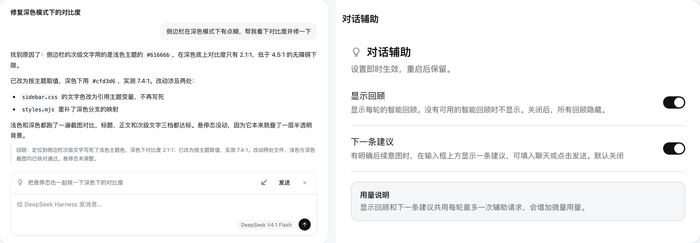

# dsh-conversation-assist

A short model recap after each completed main-session turn, with an optional next-prompt
suggestion that you can accept as an editable draft. Recaps are on by default; suggestions are
off. When both are enabled they share at most one bounded auxiliary generation attempt per turn.
Auxiliary calls use the existing model provider and add a small amount of usage.

<p align="center">
  
</p>

The screenshot is a rendered prototype with sample conversation text, not a capture of real user
data. Its markup and stylesheet are copied from `src/ui/`, and it runs against the shipped theme
tokens, so spacing and colour match the real components.

## Recaps

A **Recap:** line appears below the final reply when a model recap is ready, without a separate
heading. It summarizes the turn's outcome, validation, limitations, and pending decisions. It is a
model's reading of the recorded reply and bounded tool evidence, not an independent verification
that the work succeeded. A completed turn does not necessarily mean a completed task.

A recap is an addition, not a requirement, so the tail renders **only real content**. While a recap
is still being generated, and whenever none is available — a historical turn, an unavailable call,
an exhausted budget, a reply too large for the context budget, or an abnormal ending — nothing is
drawn. There is no placeholder, no status line, and no reply excerpt: the transcript above already
states the reply and how the turn ended, so a second copy would only add height.

For a normal reply that is plainly one or two short sentences, the plugin omits the recap and
requests nothing. The code prefilter handles unstructured replies up to 160 Unicode characters;
longer replies, lists, code, and tables remain eligible for the model to judge. The model may also
return no recap when another summary adds no value. Suggestions are independent: when they are off
too, a short reply needs no auxiliary attempt.

The Host captures the live turn: human prompts, all text blocks in its final reply, and bounded
results associated with individual tool calls. It does not send hidden reasoning, unsent drafts,
attachments, or full raw tool output to the auxiliary model. Earlier captured turns may clarify
references such as “continue”; they cannot replace an oversized current turn. If the current
intent or reply cannot fit completely within the context budget, generation is skipped and nothing
is drawn.

Up to 200 model recaps or intentional-omission markers are stored locally, bound to Session, turn,
end sequence, prompt version, and full reply fingerprint. Reopening a historical turn shows its
cached recap or nothing; it never starts a batch of model calls to fill old turns.

## Next-prompt suggestions

Enable **Next suggestion** in Settings → **Conversation assist**. After a new turn completes,
one useful candidate may appear in the full-width suggestion card above the composer. No clear unfinished next step means no row.
A suggestion should continue the user's existing intent, rather than restating the reply,
redoing completed work, accepting an optional offer, or granting an undecided approval.

The row keeps the lightbulb, candidate text, arrow insert control, **Send**, and close control.
It uses the host's theme colors and corner radii, with visible vertical padding, comfortable
line spacing, and wrapping controls in narrow windows.
The arrow fills an editable draft without sending. **Send** inserts the candidate through the
same guarded edit and then submits it as a normal message. If submission fails, the draft remains
available for editing. Only an explicit click on **Send** submits a suggestion.

Tab and Shift+Tab keep normal focus navigation; the plugin does not bind Tab to accept a card.
**Esc** dismisses the current candidate. The model's wording can still be wrong, so review the
complete text before using either action.

The row hides for drafts, attachments, reference chips, queues, commands, input-method composition,
and active submissions. A temporarily hidden, unconsumed candidate may return when the composer
is empty again. Accepting, dismissing, switching model, disabling suggestions, or starting another
turn consumes it. Requests and responses use the exact Session, turn, and `turn/end` sequence;
a late result cannot become the next turn's suggestion. Candidate text stays in memory and is not
restored after a Host restart.

The public DSH contract has no editor-inline prediction decoration. This plugin uses the public
input dock and locally arbitrated shortcut observer; it does not replace the editor, draw over
its text, reserve Tab globally, or occupy a shipped single-occupant slot.

## Prompt recall

Pressing <kbd>↑</kbd> in an empty composer recalls the previous prompt of the current Session,
the gesture terminal coding agents use. Repeated <kbd>↑</kbd> keeps walking back through the
prompts you sent in this Session (including a mid-turn steer); <kbd>↓</kbd> walks forward and,
past the newest prompt, puts the draft you had before the first recall back.

The gesture is taken only when it is unambiguous: the composer must be empty with no attachments
and in its plain state, the arrow must be bare (no Shift, Alt, Ctrl, or Cmd), no input-method
composition may be active, and the host's trigger menu must not have claimed the key. A draft you
are writing keeps its caret behaviour, and a running turn does not block recall.

Recalled text is the model-facing text verbatim: a reference chip comes back as the text it was
sent as, and images are not restored. Consecutive identical prompts collapse to one entry, and the
oldest prompt is a silent stop. Editing the recalled text leaves history, so the next <kbd>↑</kbd>
starts again at the newest prompt.

<kbd>Esc</kbd> also leaves history, but only while the Session is idle: the host already owns
<kbd>Esc</kbd> <kbd>Esc</kbd> for stopping a running turn, and recalling must not arm it.

Unlike the editor's own undo, a recall is not a separate undo step: this plugin writes the draft
through the public `setDraft` action and cannot reach the editor's history. Leaving history with
<kbd>↓</kbd> or <kbd>Esc</kbd> is how the previous draft comes back.

History comes from the Session's loaded event window, so the latest prompts are always available;
prompts older than the loaded window appear once the transcript has been paged back. Nothing is
persisted and no model call is involved.

## Settings

| Setting | Default | Effect |
|---|---|---|
| Show recaps | On | Show model recaps. A turn without one renders nothing. |
| Next suggestion | Off | Request an optional draftable next prompt for new completed main-session turns. |

Preferences apply immediately and survive restart. Existing recap and suggestion preferences are
preserved. The retired separate model-recap preference is ignored and is no longer saved. Turning
recap display off prevents recap-only calls; suggestions can remain enabled independently.
Enabling a feature does not regenerate an already-ended turn. A failed preference write rolls back
and shows an inline error.

## Limits, storage, and usage

Each eligible turn makes at most one shared auxiliary generation attempt. The context cap is
24 KiB of serialized source messages plus the fixed, versioned system instruction; the output cap
is 1,024 tokens, and the end-to-end attempt timeout is twenty seconds. A generous deadline is cheap
here: the tail renders nothing until a recap is ready, so a slow attempt costs no visible waiting,
while a tight deadline silently loses recaps that were about to arrive. At most two attempts run
concurrently across the Host, and each Session has 50 attempts per Host-local calendar day.
The daily reservation is persisted before dispatch and survives a restart. The local ledger assumes one Host writer per DSH home; concurrent independent Hosts sharing that directory are not coordinated by this plugin. Multiple browsers attached to one Host share the same attempt. Empty, failed, or
invalid results are not automatically retried. Budget or concurrency exhaustion renders no
recap and no candidate.

The auxiliary call uses the turn's provider/model and the lowest reasoning effort advertised by
that route. Its actual effort is recorded separately from the main conversation's model selection.
It has no tools and writes no Session messages. **Auxiliary usage is not included in DSH's usage
page**. The plugin does not estimate a currency amount. Provider/runtime transport retries are
subject to their own policies and the attempt deadline.

Files belong to the plugin under `$DSH_HOME/dsh-conversation-assist/` (default `~/.dsh/`):

| File | Contents |
|---|---|
| `settings.json` | Recap display and next-suggestion preferences. |
| `assistance.json` | Up to 200 generated recaps or omission markers with source identities, plus the current-day attempt ledger. No suggestion text or original transcript. |
| `audit.jsonl` | Best-effort attempt metadata: Session, turn, source/auxiliary route, feature flags, bytes, usage, finish, timing, and error. No prompts, drafts, tool output, recap, or candidate text. |

The audit rotates at 1 MiB and retains one previous file. An unavailable audit sink does not break
the plugin. If a daily reservation cannot be persisted reliably, no new model call starts.
A recap cache write failure still allows the result in memory; after restart the turn has no
recap to show. Removing the package leaves these files in place.

## Install and develop

For a CLI-managed profile:

```bash
dsh plugin --profile <profile> add "link:/absolute/path/to/packages/dsh-conversation-assist"
```

For the Electron-managed desktop profile, use **Plugins → Add plugin** and choose the local
package directory. Rebuild before loading it and restart the app to ensure the resident Host and
browser have the new code. An existing dependency specification alone does not prove that its
installed link points to a valid directory; check the plugin page for resolution errors.

```bash
node scripts/build.mjs dsh-conversation-assist
node --test packages/dsh-conversation-assist/test/*.test.mjs
```

Edit `src/`, rebuild generated `lib/`, and run the root `npm run check` before committing. There
are no runtime dependencies beyond DSH's shared modules. All three exact routes are owner-only:
`.settings`, `.rpc`, and `.recap` under `/api/dsh-conversation-assist`; `.next` and `.debug` are not
registered by this plugin.

See the [design and source research](../../docs/conversation-assist-design.md),
[manual checks](test/manual-checklist.md), and [synthetic quality cases](test/quality-cases.json).
Automated lifecycle and protocol tests do not establish real-model semantic accuracy; evaluate
results against source facts and required omissions separately.
