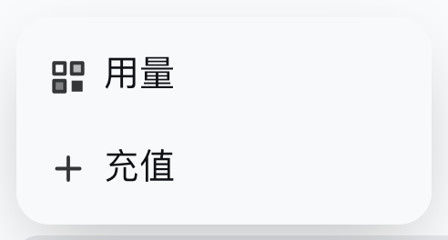
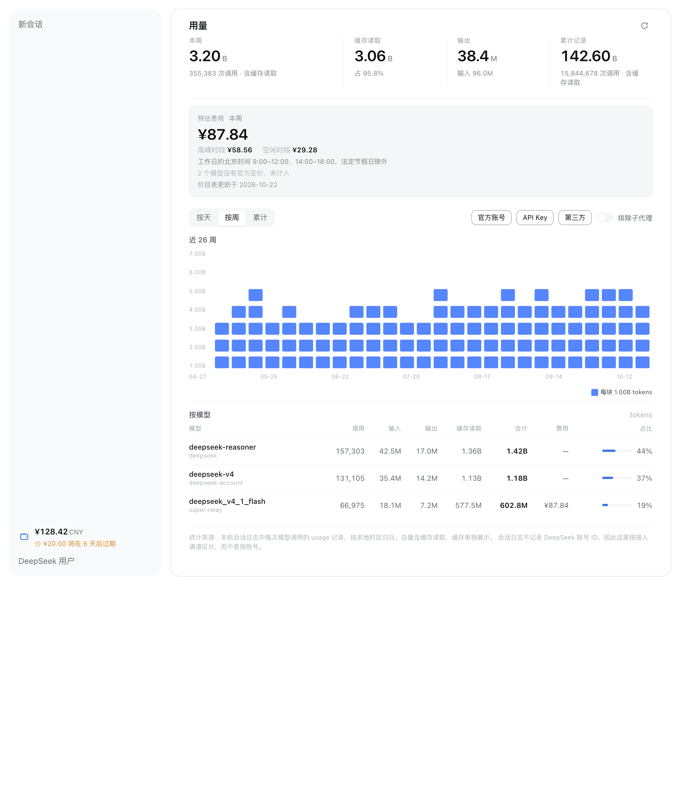
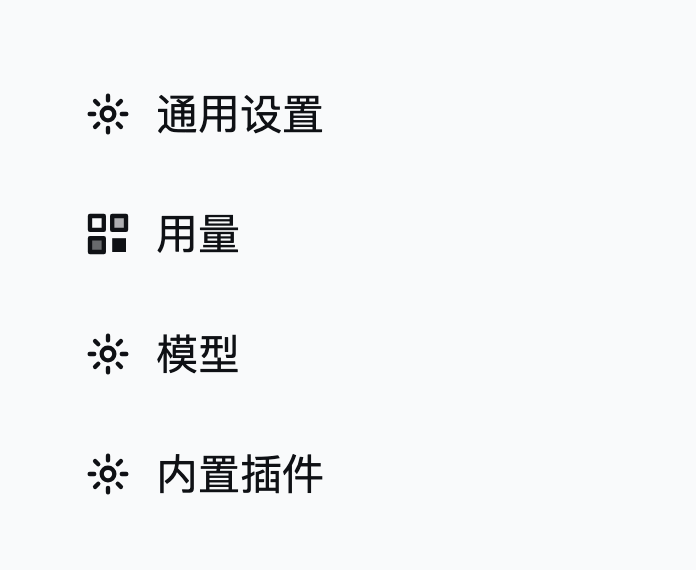

# dsh-deepseek-usage

Your DeepSeek account balance in the sidebar, and a token-usage heatmap of what this machine
actually spent.

<p align="center">
  
</p>

## What it does

**Balance row.** When a DeepSeek account credential is stored, a row appears directly above the
account launcher. It shows the spendable balance and — when granted credit is about to expire — a
second line naming the amount and how long is left. Opening the row's menu refreshes the figure and
offers **Usage** and **Top up**. With no stored credential the row is not rendered at all, and
neither is it when the balance cannot be read: a failed read cannot prove an account exists.

<p align="center">
  
</p>

**Usage page.** Tokens per day, per week, or as a weekly stack, one lane per model, filterable by
access channel. It reads the `usage` record every model call already writes into this machine's
Session logs, so it needs no network access and no DeepSeek login. Reachable from the balance menu,
from the sidebar's panel list, and from **Settings → Usage**.

<p align="center">
  
</p>

## Where the numbers come from

| Figure | Source |
|---|---|
| Balance, bonus wallets | `ctx.deepseekAccount.getBalance()` — Platform's `get_user_summary` |
| Expiry of granted credit | `ctx.deepseekAccount.getUnnotifiedBonuses()` — the only Platform field carrying an expiry |
| Token usage | `assistant/message.data.usage` in each stored Session log |
| Prices | `api-docs.deepseek.com/zh-cn/quick_start/pricing`, read at most once a day |

Two deliberate choices follow from those sources:

- **A failed balance read is never shown as `¥0.00`.** The row reads `--` and says the balance is
  temporarily unavailable, because a zero and an error mean opposite things to the person reading it.
- **This plugin never calls `ackBonusNotified`.** That call tells Platform the user has seen a
  granted-bonus notice, and Platform stops offering it. The expiry line here is a derived display
  that can be recomputed at any time, so consuming a one-shot product notification for it would be
  the wrong trade.

## What "channel" means

Session logs record the provider and model of each call but no DeepSeek account id. The usage page
therefore groups by **access channel** — DeepSeek account, API key, or third party — and labels it
that way, rather than presenting an account breakdown it cannot support.

## The three views

Each view answers a different question, and the KPI row and the cost card always describe the
period the view is showing — today, this week, or everything on record. They are never fixed.

| View | Chart | Figures describe |
|---|---|---|
| **Daily** | One colour-graded cell per day, every model summed | Today |
| **Weekly** | One block column per week, each block a fixed amount of tokens | This week, Monday to Sunday |
| **Cumulative** | One block column per week, each column the running total | Everything on record |

Every view draws its chart at the same height — the daily grid's height follows its width, and the
block charts derive theirs from the same aspect ratio — and the cost card keeps the same rows
whether or not it has a figure, so switching ranges never moves the page under the cursor.

The daily grid covers the same 26 weeks as the weekly view, is Monday-first to match its row labels,
and keeps square cells: a year of 53 columns squeezed into one panel width turns each day into a
sliver, which reads as a rendering fault rather than a calendar.

The block columns replace a colour-graded cell on purpose: a single cell has one shade and no
height, so a week that doubled looks like a week that grew tenfold. A block is countable, so
magnitude reads the way a bar chart reads.

The block size is derived from the data rather than fixed — the smallest step on a 1/2/5 ladder
that lets the tallest column fit in seven blocks — and the legend states it. A fixed unit would
draw nothing at all for a month of light use, and an empty chart cannot be told apart from "no
usage".

## Cost estimation

The usage page prices the tokens it shows, following the range switch: **Daily** covers the 12
months the heatmap draws, **Weekly** the 26 weeks, and **Cumulative** everything on record. The
headline figure splits into peak and off-peak, because the same tokens cost twice as much inside
the peak windows — that split is the actionable part of the number.

- **Peak hours** are Beijing-time weekdays 09:00–12:00 and 14:00–18:00, excluding Chinese statutory
  holidays. A call's tier is decided from its own instant while the Session log is folded, so it is
  never recomputed from the reader's clock or timezone. Weekend hours are off-peak even when a
  Saturday has been shifted into the working week.
- **The holiday schedule is bundled**, not fetched. A second network dependency would make an
  offline reader lose the tier split as well as the price, and the State Council publishes one year
  at a time. It covers 2024–2026; older history is still priced, but the page says so, because a
  missing holiday would be read as an ordinary weekday and overstate the bill.
- **Prices refresh once per local day**, when the page opens. A read failure is not remembered for
  the day, so the next visit retries; a shipped snapshot answers in the meantime, and the page says
  which of the two it is showing.
- **Only official models are priced.** A third-party relay hosting the same weights is matched by
  name (`opensource/deepseek_v4_1_flash` → the published Flash price), because it is the same model
  at the same price. Anything that is not a DeepSeek model is left unpriced and *counted* in a
  notice, never billed at zero.
- **Money is integer arithmetic.** Prices are per million tokens and arrive as decimal strings, so a
  two-decimal total computed in floating point can drift by a cent; the estimator works in
  micro-units and formats once.

## Counting rules

- Tokens are bucketed by **local calendar day**, so a total matches the day the person experienced.
- `totalTokens` already includes cache reads; the cache figure is also shown on its own because it
  usually dominates the total and would otherwise make the number look implausible.
- Delegated (subagent) Sessions are counted, with a switch to exclude them.
- The window applies to **events**, not to a Session's creation date: a Session resumed after months
  contributes only its in-window usage.
- A Session that cannot be read is counted and reported, never silently dropped.

## Install

```bash
dsh plugin --profile <profile> add "link:/absolute/path/to/packages/dsh-deepseek-usage"
```

Restart that profile. The balance row appears in the sidebar; the usage page is reachable from the
row's menu, from the sidebar's panel list, and from **Settings → Usage**.

<p align="center">
  
</p>

## Boundaries

- The row's **Usage** entry opens a **main-area panel**, not the Settings dialog. A third-party
  bundle cannot address a Settings section directly, and a year of heatmap lanes needs the wider
  column anyway. The same view is also registered as a Settings section for people who look there.
- The Settings nav glyph is chosen by the shell per section id, with no icon option for third-party
  sections. The section's label therefore carries this plugin's own mark, and a narrow rule hides
  the shell's fallback gear in that row only.
- The plugin adds no agent tool and changes no model-visible prompt.

## Build and test

From the repository root:

```bash
npm run build
npm test
```
